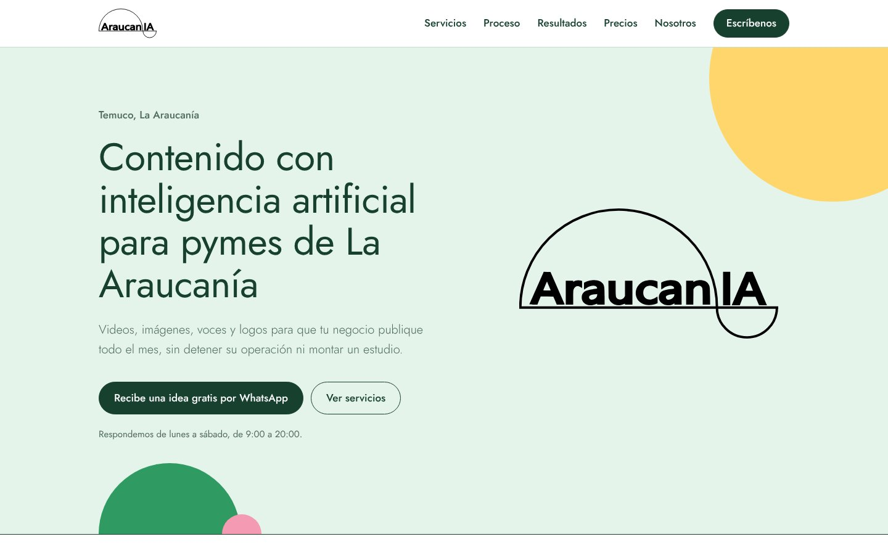
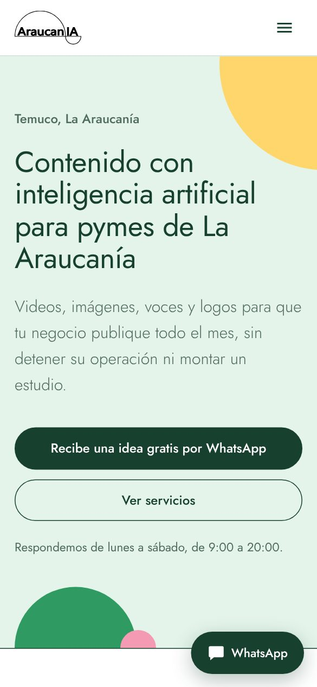

<div align="center">


# Sitio web de Araucan IA

**Contenido con inteligencia artificial para pymes de La Araucanía.**

[](https://araucania.github.io)
[](https://github.com/AraucanIA/AraucanIA.github.io/actions/workflows/pages/pages-build-deployment)
[](CHANGELOG.md)

</div>

<p align="center">
  
  &nbsp;
  
</p>

## Contenido

- [Sobre el sitio](#sobre-el-sitio)
- [Estructura del repositorio](#estructura-del-repositorio)
- [Trabajar en el sitio](#trabajar-en-el-sitio)
- [Identidad visual](#identidad-visual)
- [Publicación](#publicación)
- [Hoja de ruta e historial](#hoja-de-ruta-e-historial)
- [Contacto](#contacto)
- [Derechos y licencias](#derechos-y-licencias)

## Sobre el sitio

Sitio de una página que presenta los servicios de Araucan IA SpA (Temuco), con el contenido y la identidad visual del brochure y el tarifario de octubre de 2026.

- **Secciones:** portada, servicios de contenido, más soluciones (incluidas las tarjetas NFC de reseñas), cómo trabajamos, por qué Araucan IA, resultados y clientes, formatos y precios, quiénes somos y contacto.
- **Tecnología:** HTML, CSS y un poco de JavaScript. Sin frameworks, dependencias ni paso de compilación.
- **Pensado para celulares:** diseño adaptable y botón fijo de WhatsApp en pantallas pequeñas.
- **Accesible:** contraste AA, navegación con teclado, textos alternativos y enlace para saltar al contenido. Revisado con axe sin observaciones.
- **SEO:** título y descripción, imagen para compartir en redes (Open Graph), datos estructurados de negocio local, `sitemap.xml` y `robots.txt`.
- **Liviano y privado:** la página completa pesa unos 250 KB, la tipografía se aloja en el sitio y no hay cookies ni rastreo.

## Estructura del repositorio

```text
.
├── index.html                 Página del sitio
├── 404.html                   Página para enlaces rotos
├── favicon.ico
├── robots.txt                 Instrucciones para buscadores
├── sitemap.xml                Mapa del sitio
├── assets/
│   ├── css/styles.css         Estilos (colores y tipografía en :root)
│   ├── js/main.js             Menú en celulares
│   ├── fonts/                 Tipografía Jost y su licencia
│   ├── icons/                 Favicon e íconos de la marca
│   └── img/
│       ├── marca/             Logos oficiales en SVG
│       ├── clientes/          Fotos de clientes
│       └── og-araucania.jpg   Imagen para compartir en redes
├── docs/
│   ├── ROADMAP.md             Mejoras hechas y pendientes
│   ├── MIGRACION.md           Notas de la migración desde Google Sites
│   └── capturas/              Imágenes de este README
├── CHANGELOG.md               Historial de versiones
└── README.md
```

## Trabajar en el sitio

### Ver los cambios en tu computador

- Abre `index.html` con doble clic en tu navegador, o
- en VS Code, usa la extensión **Live Server** (**Go Live**), o
- desde una terminal en esta carpeta: `python -m http.server` y abre <http://localhost:8000>.

### Flujo de trabajo

1. Crea una rama para cada mejora, por ejemplo `mejora/testimonios`.
2. Haz los cambios y súbelos a esa rama.
3. Abre un *Pull Request* hacia `main`, revisa los cambios y fusiónalo.
4. GitHub Pages publica la nueva versión en uno o dos minutos.

Desde la web de GitHub también sirve: edita un archivo con el lápiz o usa **Add file → Upload files**, y elige **Create a new branch for this commit and start a pull request**.

### Dónde cambiar cada cosa

| Qué | Dónde |
| --- | --- |
| Textos, servicios y precios | `index.html`. Cada sección tiene su ancla: `#servicios`, `#soluciones`, `#proceso`, `#resultados`, `#precios`, `#nosotros`, `#contacto`. |
| Colores y tipografía | Variables de `:root` al inicio de `assets/css/styles.css`. |
| Fotos de clientes | `assets/img/clientes/`, en WebP, cuadradas y de unos 560 px. |
| Enlace de WhatsApp | `https://wa.me/message/2SJY6SYY5FPGD1`, repetido en `index.html`. |
| Datos para buscadores | Bloque `application/ld+json` en `index.html` (horario, redes, contacto). |
| Imagen para compartir | `assets/img/og-araucania.jpg`, de 1200 × 630 px. |
| Fecha del mapa del sitio | `lastmod` en `sitemap.xml`, al publicar cambios grandes. |

## Identidad visual

La web sigue el brochure y el tarifario: tipografía **Jost** (300, 400 y 500), fondos claros, verde oscuro para títulos y botones, y círculos de color como elementos gráficos.

| Color | Hex | Uso |
| --- | --- | --- |
| Verde oscuro | `#17402F` | Títulos, botones y fondo de contacto |
| Gris verdoso | `#4F6B5E` | Texto de párrafos |
| Verde | `#2F9B63` | Líneas, marcadores y formas (no para texto pequeño) |
| Menta | `#E4F4EA` | Portada y cajas destacadas |
| Celeste claro | `#DDEFF8` | Sección "Por qué Araucan IA" |
| Celeste | `#7CC3E6` | Acentos |
| Rosado | `#F49AB2` | Acentos y formas |
| Amarillo | `#FFD66B` | Círculo de la portada |
| Bordes | `#C9DDD1` | Líneas y bordes de tarjetas |
| Texto claro | `#BFD9CB` | Texto sobre verde oscuro |

Logos en `assets/img/marca/`: negro sobre fondos claros y blanco sobre verde oscuro.

## Publicación

GitHub Pages publica la rama `main` (carpeta raíz) en <https://araucania.github.io>, con HTTPS. Cada cambio en `main` se publica solo; el avance se ve en la pestaña **Actions**.

## Hoja de ruta e historial

- Mejoras pendientes: [docs/ROADMAP.md](docs/ROADMAP.md)
- Historial de versiones: [CHANGELOG.md](CHANGELOG.md)
- Migración desde Google Sites: [docs/MIGRACION.md](docs/MIGRACION.md)

## Contacto

- WhatsApp: [+56 9 3108 1739](https://wa.me/56931081739)
- Correo: [araucania.contacto@gmail.com](mailto:araucania.contacto@gmail.com)
- Instagram y TikTok: [@araucan.ia](https://www.instagram.com/araucan.ia/)
- LinkedIn: [Araucan IA](https://www.linkedin.com/company/araucan-ia/)

## Derechos y licencias

© 2026 Araucan IA SpA. La marca, los textos y las imágenes pertenecen a Araucan IA y a sus clientes; todos los derechos reservados. La tipografía Jost se distribuye bajo la licencia SIL Open Font License 1.1 (ver [assets/fonts/LICENCIAS.md](assets/fonts/LICENCIAS.md)).
